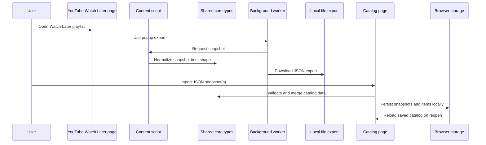
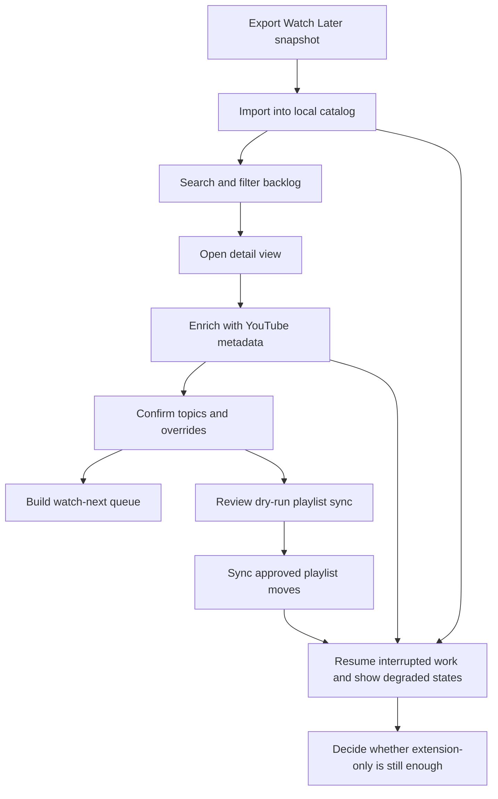

# yt-wl-mgr architecture

## Overview

`yt-wl-mgr` is building toward a local-first workflow for taking a YouTube Watch Later backlog from raw browser capture to reviewable playlist syncs. The current extension now covers export plus a local catalog import/browse flow:

- `apps/extension/src/background.ts` installs the MV3 service worker and serves popup export requests.
- `apps/extension/src/content/watchLaterSnapshot.ts` scans the Watch Later playlist DOM and produces a normalized snapshot.
- `apps/extension/src/catalog.ts` powers the extension-managed catalog page for importing, searching, filtering, and inspecting saved items.
- `packages/core/src/index.ts` holds the shared domain types, advanced search helpers, and deterministic category/priority heuristics used by export and import flows.

## Current workspace architecture

| Area | Role | Current state |
| --- | --- | --- |
| `apps/extension` | Cross-browser WebExtensions runtime | Manifest, background worker, popup export flow, and local catalog page exist |
| `packages/core` | Shared domain model | Exposes snapshot, catalog, enrichment, search, and deterministic suggestion types |
| Browser storage | Local persistence | Stores imported snapshots and derived catalog entries in extension-local storage |
| Extension UI pages | Import/catalog/review UI | Import, search/filter, and detail UI implemented; review flows still planned |
| YouTube Data API | Enrichment and playlist sync | Planned, not yet implemented |

## Cross-browser design baseline

This project should follow MDN's guidance for building a cross-browser extension:

- <https://developer.mozilla.org/en-US/docs/Mozilla/Add-ons/WebExtensions/Build_a_cross_browser_extension>

The current baseline choices that fall out of that guidance are:

- use the `browser.*` WebExtensions namespace in the extension runtime
- keep API differences behind a small adapter instead of scattering `if Firefox` or `if Chrome` branches
- prefer Promise-based async calls where the shared WebExtensions surface supports them
- bundle extension entrypoints so shipped content scripts stay classic scripts instead of relying on module loading support
- keep the MV3 background runtime service-worker friendly and avoid state that assumes a persistent background page

## Current runtime boundaries

```mermaid
graph LR
  User[User in browser]
  YT[YouTube Watch Later page]
  CS[Content script\nwatchLaterSnapshot.ts]
  BG[Background service worker\nbackground.ts]
  Core[@yt-wl-mgr/core\nshared types]
  Store[(Browser local storage)]
  UI[Extension pages\nimport / catalog]
  FutureAPI[YouTube Data API]

  User --> YT
  YT --> CS
  CS --> Core
  BG --> User
  CS --> BG
  UI --> Store
  UI --> Core
  BG -. future enrich/sync .-> FutureAPI
```

## Current ingestion flow

Today the popup requests a normalized snapshot from the active Watch Later tab and saves it as a JSON export. The catalog page then imports one or more exports into extension-local storage, deduplicates them into a searchable catalog, and derives lightweight category / priority suggestions from the local metadata without using an LLM.



## Planned application pipeline

The backlog is now organized around complete product slices that move a single user workflow all the way forward before starting the next layer of infrastructure.



## Architectural intent by layer

### 1. Ingestion

- **Source of truth for first capture:** the Watch Later page DOM.
- **Why:** it avoids depending on API access just to get the backlog out.
- **Code anchor:** `apps/extension/src/content/watchLaterSnapshot.ts`.

### 2. Shared domain model

- **Role:** define portable shapes for snapshot items, catalog records, enriched metadata, deterministic watch suggestions, and playlist sync suggestions.
- **Why:** the same objects should flow through export, import, catalog, and sync surfaces.
- **Code anchor:** `packages/core/src/index.ts`.

### 3. Local catalog

- **Current runtime:** browser-managed extension storage plus extension pages.
- **Responsibility:** persist imports, deduplicate entries, derive local-first category / priority signals, and surface search/filter/detail workflows.
- **Constraint:** keep it ergonomic for a large backlog before introducing a separate local app.

### 4. API-backed enrichment and sync

- **Planned boundary:** background worker owns OAuth tokens and outbound YouTube API requests.
- **Responsibility:** fetch richer metadata, resolve playlist IDs, and perform approved writes.
- **Constraint:** API use augments the local model rather than replacing browser-driven ingestion.

## Code-level notes

- The TypeScript project uses project references from the workspace root so `packages/core` can compile before `apps/extension`.
- `apps/extension` targets `ES2022` with DOM libraries because the content script and catalog page run in the browser.
- `packages/core` targets `ES2022` without DOM libraries because it should stay runtime-agnostic.

## Near-term architecture priorities

1. Harden degraded-state handling for incomplete or corrupted local data.
2. Add richer metadata enrichment and queue-building flows on top of the catalog.
3. Keep shared types in `packages/core` as the contract between ingestion, catalog UI, and future sync flows.
4. Add background-worker message passing only when persistence or API calls require it.
