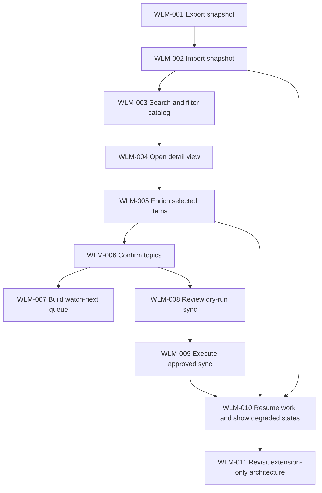

# yt-wl-mgr vertical backlog slices

The backlog in `backlog/issues.json` is now organized around **end-to-end user-visible slices** instead of capability layers like “storage”, “OAuth”, or “rules engine” by themselves.

## Slicing rules

Each issue should:

1. deliver a user-visible outcome on its own
2. cross whatever layers are needed to make that outcome real
3. be manually testable without depending on unfinished sibling issues
4. leave behind a stable artifact such as a file export, persisted catalog state, queue, review plan, or sync log

## Slice progression

## Why this is more vertical

The previous backlog grouped large horizontal capabilities together, for example:

- export
- import and catalog
- enrichment
- topic labeling
- queue generation
- review
- sync

That shape still described the product, but many issues were broad layers rather than complete features. The revised backlog changes the unit of delivery to workflows such as:

- export a real file
- import it and reopen a persistent catalog
- inspect a detail view for one item
- enrich selected items and see the merged result
- confirm a topic and use it in later flows
- preview a sync plan before writing anything

## Validation style per slice

| Slice | Primary proof that it is done |
| --- | --- |
| `WLM-001` | A local JSON snapshot can be exported from the Watch Later page |
| `WLM-002` | Imported data survives closing and reopening the extension |
| `WLM-003` | Search and filters narrow the local catalog correctly |
| `WLM-004` | One selected item opens in a detail view with imported metadata |
| `WLM-005` | Enriched metadata appears and persists on a catalog item |
| `WLM-006` | A manual label override persists and becomes authoritative |
| `WLM-007` | A time-budget queue can be generated and adjusted |
| `WLM-008` | A dry-run playlist plan can be reviewed and partially approved |
| `WLM-009` | Approved playlist actions execute and produce a sync log |
| `WLM-010` | Interrupted work resumes without losing completed progress |
| `WLM-011` | A documented architecture decision is recorded from observed constraints |
